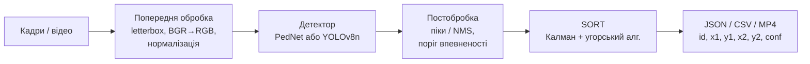
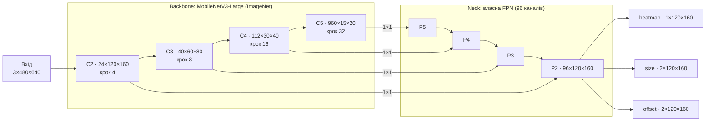
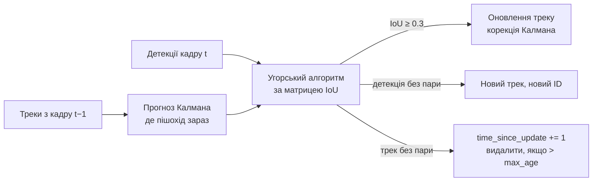

# PedVision — виявлення та відстеження пішоходів
### Ходаков Максим Олегович, ШІ-2

Система знаходить і відстежує пішоходів на відео з камери, встановленої на лобовому склі автомобіля.

* **Вхід:** послідовність кадрів (папка зображень, упорядкована за іменем) або відеофайл.
* **Вихід:** для кожного кадру — список прямокутників `track_id, x1, y1, x2, y2, conf` (JSON + CSV, за бажанням анотоване відео MP4).

У проєкті три моделі детекції та власний трекер:

| Компонент | Файл | Що це |
|---|---|---|
| **PedNet** | `pedestrian/pednet.py` | власний anchor-free детектор центрів пішоходів (MobileNetV3 + власні FPN і голови), навчений з нуля в проєкті |
| **YOLOv8n Caltech** | `train_yolo.py` | YOLOv8n від Ultralytics, донавчена на Caltech Pedestrian |
| **YOLOv8n COCO** | `models/yolov8n.pt` | та сама модель «з коробки» (COCO, клас `person`) — базова лінія для порівняння |
| **SORT** | `pedestrian/sort_tracker.py` | власна реалізація трекера: фільтр Калмана + угорський алгоритм |

Дані: **Caltech Pedestrian** (навчання / валідація / тест) і **INRIA Person** (незалежний тест з іншого домену).

---

## Зміст
1. [Швидкий старт](#1-швидкий-старт)
2. [Як працює система](#2-як-працює-система)
3. [Дані](#3-дані)
4. [Архітектура PedNet](#4-архітектура-pednet)
5. [Архітектура YOLOv8n](#5-архітектура-yolov8n)
6. [Трекер SORT](#6-трекер-sort)
7. [Оцінювання та метрики](#7-оцінювання-та-метрики)
8. [Результати](#8-результати)
9. [Веб-платформа](#9-веб-платформа)
10. [Структура проєкту](#10-структура-проєкту)
11. [Як додати свою модель](#11-як-додати-свою-модель)
12. [Обмеження та подальші кроки](#12-обмеження-та-подальші-кроки)

---

## 1. Швидкий старт

```bash
pip install -r requirements.txt

python prepare_inria.py                  # INRIA -> YOLO-формат (dataset/inria)
python train_yolo.py --epochs 12         # донавчання YOLOv8n -> models/yolo_caltech_v8n.pt
python train_pednet.py --epochs 15       # навчання PedNet    -> models/pednet_best.pt
python evaluate.py                       # метрики та графіки -> reports/

# трекінг послідовності кадрів -> JSON/CSV (+ відео)
python track.py --source dataset/datasets/images/test/caltechpedestriandataset/set06 \
                --pattern "set06_V016_*" --model pednet --out outputs/set06_V016.json --save-video

python -m streamlit run app.py           # веб-платформа
```

Корисні прапорці:

| Скрипт | Прапорець | Значення |
|---|---|---|
| `train_pednet.py` | `--limit 200 --epochs 1` | швидка перевірка, що навчання запускається |
| `train_pednet.py` | `--resume runs/pednet/last.pt` | продовжити перерване навчання |
| `train_yolo.py` | `--resume <.../weights/last.pt>` | продовжити навчання YOLO |
| `evaluate.py` | `--step 10` | оцінка на кожному 10-му кадрі Caltech (швидко) |
| `evaluate.py` | `--models pednet yolo_coco` | оцінити лише вибрані моделі |
| `track.py` | `--model yolo_caltech` | будь-який ключ з `MODEL_ZOO` (див. розділ 11) |
| `track.py` | `--conf 0.3 --max-age 15 --min-hits 2` | поріг детектора та параметри трекера |

Пристрій обирається автоматично: `cuda` → `mps` (Apple Silicon) → `cpu`. Перевизначити можна змінною середовища `PED_DEVICE=cpu`.

---

## 2. Як працює система



Для кожного кадру (`track.py → run_tracking`):

1. **Попередня обробка** (`pedestrian/data.py`). Кадр масштабується **letterbox**: єдиний коефіцієнт `s` для обох осей і сірі смуги (значення 114) до розміру входу мережі. Пропорції не спотворюються, тому пішоходи не стають «товстішими» чи «тоншими». Далі BGR → RGB і стандартизація за середнім і стандартним відхиленням ImageNet (так навчався backbone MobileNetV3).
2. **Детекція.** Детектор повертає масив `(N, 5)`: `x1, y1, x2, y2, score` у пікселях **оригінального** кадру. Обернений letterbox `x = (x' − pad_x) / s` виконується всередині обгортки детектора (`pedestrian/detectors.py`).
3. **Постобробка.** Відкидаються рамки з `score < conf`, дублікати прибирає NMS (IoU 0.5). Для кожної моделі за замовчуванням береться свій оптимальний поріг — точка максимального F1 на Caltech test (`default_conf()` читає його з `reports/metrics.csv`). Це потрібно, бо «шкала» впевненості в моделей різна: піки heatmap PedNet рідко сягають 1.0.
4. **Відстеження.** SORT зіставляє детекції з наявними треками й призначає кожному пішоходу сталий `track_id` (розділ 6).
5. **Вихід.** Для кожного кадру формується запис:

```json
{"frame": 5, "file": "set07_V011_0005.png", "ms": 41.2,
 "boxes": [{"track_id": 1, "x1": 424.9, "y1": 168.9, "x2": 456.5, "y2": 244.5, "conf": 0.643}]}
```

`ms` — повний час обробки кадру (пре- і постобробка, мережа, трекер).

Усі детектори реалізують один інтерфейс `Detector.predict(frame_bgr, conf, iou) -> (N, 5)`, тож трекінг, оцінювання і веб-інтерфейс не залежать від того, яка модель усередині.

---

## 3. Дані

### Caltech Pedestrian
Близько 10 годин відео 640×480 з камери на лобовому склі (Лос-Анджелес). Використано готову збірку у форматі YOLO (`dataset/datasets/`):

| Вибірка | Сети | Кадрів | Використано | Призначення |
|---|---|---|---|---|
| train | set00–05 | 12 780 | кожен 2-й → 6 390 | навчання |
| val | set00–05 | 3 222 | кожен 4-й → 806 | вибір найкращої епохи |
| test | set06–10 | 4 002 | усі | підсумкова оцінка, трекінг |

Сусідні кадри відео майже однакові, тому проріджування майже не зменшує різноманітність даних, але вдвічі скорочує епоху.

Важливі особливості цієї збірки:
* розмічено **лише пішоходів висотою ≥ 75 px** (медіана близько 90 px). Дрібніших пішоходів у кадрах видно, але розмітки для них немає. Тому в оцінюванні є протокол `h60` (розділ 7);
* **val і train узято з тих самих відео**: 99.7 % валідаційних кадрів мають сусідній кадр (на відстані ≤ 2 кадрів) у train. Валідаційні метрики через це завищені (AP50 0.93 на val проти 0.68 на test), тож об'єктивна оцінка — лише на test.

### INRIA Person
Фотографії людей у різних позах і сценах, не з автомобіля. Використовується як **незалежний тест з іншого домену**: 288 зображень, 597 пішоходів. `prepare_inria.py` завантажує архів з Kaggle і конвертує анотації PASCAL VOC (XML, кути в пікселях) у формат YOLO.

### Формат YOLO
Для кожного `images/.../name.png` є `labels/.../name.txt`. Один рядок відповідає одному об'єкту:
```
0 0.5164 0.4031 0.0484 0.1531     # клас x_center y_center width height (частки від розміру кадру)
```
`read_boxes()` переводить ці значення в пікселі `x1, y1, x2, y2`.

---

## 4. Архітектура PedNet

PedNet — однокласовий **anchor-free** детектор у стилі CenterNet («Objects as Points»). Кожен пішохід описується однією точкою (центром рамки) і двома атрибутами: розміром і субпіксельним зсувом центру. Якорі (anchor boxes) не потрібні, тому не потрібне і складне зіставлення якорів з об'єктами.



### 4.1 Backbone (`Backbone`)
MobileNetV3-Large з torchvision з вагами ImageNet. Класифікаційну частину відкинуто. Шари `features` розрізано на 4 стадії там, де мережа зменшує роздільність, і з них беруться карти C2–C5 з кроками 4, 8, 16, 32. Неглибокі карти (C2) зберігають дрібні деталі й точну геометрію, глибокі (C5) — семантику: «що це за об'єкт».

### 4.2 Neck — власна піраміда ознак (`FPNNeck`)
Злиття згори вниз:
1. кожна карта `Cᵢ` проєктується згорткою 1×1 у 96 каналів (бічне з'єднання);
2. глибша карта збільшується вдвічі (nearest) і **додається** до поточної;
3. сума уточнюється блоком `DWSeparable`: depthwise 3×3 → pointwise 1×1 → залишкове з'єднання `x + f(x)` (BatchNorm + Hardswish після кожної згортки).

Маршрут `P5 → P4 → P3 → P2`. Результат — одна карта P2 з **кроком 4** (120×160 для кадру 640×480). Такий малий крок свідомо обрано під пішоходів: людина шириною 30–40 px займає на карті з кроком 32 лише одну комірку, а на кроці 4 — 8–10 комірок. Depthwise-separable згортки дешевші за звичайні 3×3 приблизно у 8–9 разів.

### 4.3 Голови (`Head`)
Три незалежні голови на P2, кожна має вигляд `conv 3×3 → DWSeparable → conv 1×1`:

| Голова | Канали | Що передбачає | Ініціалізація |
|---|---|---|---|
| `hm` | 1 | логіт імовірності «тут центр пішохода» | bias = −2.19, тобто sigmoid ≈ 0.1 на старті (як у RetinaNet), інакше мільйони фонових комірок дають величезний початковий loss |
| `size` | 2 | `log(w), log(h)` рамки в комірках | bias = 1.0 → exp(1) ≈ 2.7 комірки |
| `off` | 2 | дробовий зсув центру всередині комірки (0..1) | 0 |

Логарифм розміру вирівнює масштаби: помилка 5 px для 40-піксельного пішохода і 25 px для 200-піксельного дають близькі значення втрати.

### 4.4 Цілі навчання (`build_targets` у `data.py`)
* **heatmap** — для кожного пішохода в його центрі малюється **еліптичний гаусіан**. Радіус обчислюється як у CenterNet: найбільший зсув центру, за якого рамка ще має IoU ≥ 0.7 з істинною. Горизонтальний радіус додатково множиться на √(w/h), бо людина висока й вузька і допустимий зсув уліво-вправо менший. У перекриттях береться максимум, а не сума.
* **size / off / ind / mask** записуються в `max_objs = 128` слотів, щоб кадри з різною кількістю людей збиралися в один батч. `ind = y·W + x` — індекс комірки центру, `mask` позначає заповнені слоти.
* Пішоходи нижчі за 8 px не використовуються.

### 4.5 Функція втрат (`pednet_loss`)
```
L = L_hm + 1.0 · L_size + 1.0 · L_off
```
* **L_hm** — focal loss зі зниженим штрафом (CornerNet/CenterNet), α = 2, β = 4. Множник `(1 − Y)^β` зменшує штраф за передбачення поруч із центром (це «майже правильна» відповідь), а `p^α` / `(1 − p)^α` зменшують вагу легких фонових комірок.
* **L_size, L_off** — L1, але **лише в центрах реальних пішоходів**: `gather` дістає передбачення з комірок `ind`, `mask` відкидає порожні слоти.

### 4.6 Декодування (`decode`)
1. `sigmoid(hm)` → імовірності;
2. **пошук піків**: комірка лишається, тільки якщо вона максимум у вікні 3×3 (`max_pool2d`) — дешевий аналог NMS;
3. `top-100` піків з імовірністю ≥ `conf`;
4. центр = `(x + off_x, y + off_y)`, розмір = `exp(size)`, усе множиться на крок 4 → пікселі;
5. додатковий NMS (IoU 0.5) прибирає дублікати перекритих пішоходів (на CPU, бо на MPS `nms` підтримується не в усіх версіях torchvision).

### 4.7 Навчання (`train_pednet.py`)

| Параметр | Значення |
|---|---|
| Оптимізатор | AdamW, weight decay 1e-4 |
| Learning rate | 1.5e-3 для FPN і голів, 0.75e-3 для backbone (він уже навчений, тож донавчаємо обережніше) |
| Розклад | лінійний warmup 500 ітерацій → косинусне зменшення до 1 % |
| Батч / епохи | 16 / 15 |
| Аугментації | масштаб 0.75–1.35 з обрізанням (рамки, від яких лишилося < 40 % площі, видаляються), горизонтальне віддзеркалення (p = 0.5), насиченість і яскравість ×U(0.6; 1.4) у HSV |
| Стабілізація | gradient clipping (норма 10) |
| Вибір моделі | AP50 на val після кожної епохи → найкраща в `models/pednet_best.pt` |
| Логи | `runs/pednet/history.csv` (втрати та метрики по епохах) |

Одна епоха на Apple M1 (MPS) триває близько 16 хв.

### 4.8 Розмір

| Частина | Параметрів |
|---|---|
| Backbone MobileNetV3 | 2.97 млн |
| Власна FPN | 0.14 млн |
| Три голови | 0.18 млн |
| **Разом** | **3.29 млн** (файл 12.8 МБ, float32) |

---

## 5. Архітектура YOLOv8n

YOLOv8n (nano) — найменша модель сімейства YOLOv8 від Ultralytics. Ми її не змінюємо, а **донавчаємо** на Caltech, щоб порівняти з PedNet.

| Частина | Будова |
|---|---|
| Backbone | CSPDarknet з блоками **C2f** (розділення потоку ознак + конкатенація гілок) і **SPPF** (пулінг кількох масштабів) |
| Neck | **PAN-FPN**: шлях згори вниз (семантика) + знизу вгору (точна локалізація) |
| Head | **anchor-free, decoupled**: окремі гілки класифікації та регресії на трьох масштабах (кроки 8, 16, 32) |
| Рамка | розподіл відстаней від точки до чотирьох сторін (**DFL**, Distribution Focal Loss) |
| Втрати | BCE (клас) + **CIoU** + DFL (рамка); цілі призначає **TaskAlignedAssigner** |
| Розмір | 3.01 млн параметрів (один клас), файл 5.9 МБ (float16) |

Порівняно з PedNet у YOLOv8n грубіший крок (8 проти 4), але досконаліша регресія рамок (CIoU + DFL проти L1 на логарифмах) і **весь детектор** попередньо навчено на COCO, а не лише backbone.

### Донавчання (`train_yolo.py`)
* стартові ваги — `yolov8n.pt` (COCO, 80 класів); `single_cls=True` залишає один клас `person`;
* 12 епох, `imgsz=640`, батч 16, косинусний розклад LR, `optimizer=auto` → Ultralytics обрав **AdamW, lr = 0.002**;
* аугментації Ultralytics за замовчуванням: **mosaic** (4 кадри в одному), HSV (h 0.015, s 0.7, v 0.4), фліп 0.5, масштаб ±50 %, зсув ±10 %. Mosaic вимикається на останніх 10 епохах (`close_mosaic=10`);
* найкращі ваги копіюються в `models/yolo_caltech_v8n.pt`.

`models/finetuned_best.pt` — попередня версія (5 епох на всіх кадрах з батчем 8). Вона трохи краща за 12-епохову, бо зробила більше кроків оптимізації (~8000 проти ~4800).

### YOLOv8n COCO (з коробки)
Та сама модель без донавчання. Обгортка `YOLODetector` фільтрує вихід, залишаючи лише клас `person`. Показує, наскільки важливе навчання на даних цільового домену.

---

## 6. Трекер SORT

Парадигма **tracking-by-detection**: детектор знаходить пішоходів на кожному кадрі незалежно, а трекер пов'язує ці детекції в траєкторії.



* **Стан треку:** `[cx, cy, s, r, vcx, vcy, vs]` — центр, площа, співвідношення сторін і швидкості центру та площі. Швидкості не вимірюються, їх оцінює фільтр.
* **Фільтр Калмана** з моделлю сталої швидкості (`KalmanBoxFilter`): `predict()` зсуває рамку на оцінену швидкість, `update()` уточнює стан за новою детекцією, зважуючи прогноз і вимір через коефіцієнт Калмана.
* **Зіставлення:** `scipy.optimize.linear_sum_assignment` за матрицею `−IoU` (максимальний сумарний IoU); пари з IoU < 0.3 відкидаються.
* **Параметри:**
  * `max_age = 15` — трек живе до 15 кадрів без детекції, за прогнозом. Це дозволяє пережити короткі перекриття;
  * `min_hits = 2` — трек з'являється у виході після 2 підтверджень поспіль. Це відсіює поодинокі хибні спрацювання.
* Трекер додає менше 1 мс на кадр.

---

## 7. Оцінювання та метрики

Усі моделі оцінюються **одним кодом** (`pedestrian/metrics.py`) на одних і тих самих кадрах (`evaluate.py`).

* **Зіставлення:** детекції перебираються за спаданням впевненості; детекція з IoU ≥ 0.5 з ще не зайнятим пішоходом — TP, інакше FP (зокрема дублікати).
* **Precision, Recall, F1** — у точці максимального F1. Поріг цієї точки (`best_conf`) потім використовується як робочий поріг моделі.
* **AP50** — площа під кривою Precision–Recall при IoU ≥ 0.5 (101-точкова інтерполяція, як у COCO). **AP50-95** — середнє за IoU від 0.5 до 0.95; ця метрика чутлива до точності меж рамки.
* **MR⁻²** (log-average miss rate) — стандартна метрика Caltech: середнє геометричне частки пропусків у 9 точках FPPI (хибних спрацювань на кадр) від 10⁻² до 10⁰. Менше — краще.
* **Протокол `h60`:** у цій збірці Caltech розмічено лише пішоходів ≥ 75 px, тож незіставлені детекції нижчі за 60 px (75/1.25) не рахуються хибними, як в оригінальному протоколі Caltech.
* **Швидкість** вимірюється з урахуванням пре- і постобробки; перші 5 кадрів (прогрів GPU) не враховуються.
* **Трекінг:** розмітка не містить ID пішоходів, тому MOTA/IDF1 обчислити неможливо. Замість них рахується кількість треків, середня довжина треку і FPS на 5 найдовших послідовностях test (`reports/tracking.csv`).

Результати зберігаються в `reports/`: `metrics.csv`, `curves.npz`, `curves_*.png`, `speed.png`, `training_curves.png`, `tracking.csv`, `samples/`.

---

## 8. Результати

Якість на тестових вибірках (IoU ≥ 0.5):

| Модель | Вибірка | Precision | Recall | AP50 | AP50-95 | MR⁻², % |
|---|---|---|---|---|---|---|
| **PedNet (власна)** | Caltech | 0.790 | 0.653 | **0.677** | 0.357 | 47.8 |
| YOLOv8n, донавчена (12 еп.) | Caltech | 0.783 | 0.656 | 0.674 | 0.382 | **46.6** |
| YOLOv8n, донавчена (5 еп.) | Caltech | 0.768 | 0.686 | **0.690** | **0.390** | 46.9 |
| YOLOv8n COCO (з коробки) | Caltech | 0.654 | 0.572 | 0.544 | 0.218 | 60.0 |
| PedNet (власна) | INRIA | 0.581 | 0.318 | 0.322 | 0.124 | 79.0 |
| YOLOv8n, донавчена (12 еп.) | INRIA | 0.751 | 0.539 | 0.601 | 0.204 | 58.2 |
| YOLOv8n COCO (з коробки) | INRIA | 0.930 | 0.918 | **0.948** | **0.638** | **11.6** |

Швидкість на Apple M1 (MPS), кадр 640×480, з пре- і постобробкою:

| Модель | Параметрів | Розмір | мс/кадр | FPS |
|---|---|---|---|---|
| PedNet | 3.29 млн | 12.8 МБ | 41.4 | 24 |
| YOLOv8n, донавчена | 3.01 млн | 5.9 МБ | 24.9 | 40 |
| YOLOv8n COCO | 3.15 млн | 6.2 МБ | 36.5 | 27 |

Висновки:
* **На Caltech PedNet не поступається донавченій YOLOv8n** (AP50 0.677 проти 0.674), але точність меж у неї нижча (AP50-95 0.357 проти 0.382) через простішу регресію розміру.
* **Навчання на даних цільового домену критичне:** модель COCO на автомобільних кадрах дає лише AP50 0.544.
* **На іншому домені (INRIA) картина протилежна:** найкраща модель COCO (0.948), PedNet найгірша (0.322). У PedNet на ImageNet навчено лише backbone, а FPN і голови бачили тільки Caltech.
* **PedNet повільніша за YOLOv8n не через мережу, а через пре- і постобробку:** letterbox і NMS у PedNet виконуються на CPU (NumPy), а Ultralytics має оптимізований конвеєр.

---

## 9. Веб-платформа

`python -m streamlit run app.py`. Логіки в `app.py` немає: детекцію і трекінг він бере з `pedestrian/` і `track.py`.

| Вкладка | Що робить |
|---|---|
| Огляд | схема конвеєра, ключові метрики моделей |
| Фото | оригінал і результат поруч, таблиця прямокутників |
| Відео й трекінг | обробка відео з прогресом, ID і траєкторії, графік кількості пішоходів, завантаження MP4/JSON/CSV |
| Послідовність кадрів | обробка папки кадрів або послідовності Caltech, перегляд кожного кадру та його JSON |
| Порівняння моделей | дві моделі на одному кадрі, інтерактивні криві PR і MR–FPPI |
| Навчання і метрики | криві навчання, таблиця метрик |

У бічній панелі обираються модель (з позначкою «власна / донавчена / з коробки»), пороги впевненості й NMS та параметри трекера. Моделі кешуються (`st.cache_resource`) і не перезавантажуються після кожної дії.

---

## 10. Структура проєкту

```
pedestrian/                 пакет з усією логікою
  data.py                   YOLO-датасети, letterbox, нормалізація, аугментації, цілі PedNet
  pednet.py                 PedNet: Backbone, FPNNeck, Head, focal loss, decode
  detectors.py              інтерфейс Detector, обгортки PedNet/YOLO, реєстр MODEL_ZOO
  sort_tracker.py           SORT: KalmanBoxFilter, Track, SortTracker
  metrics.py                IoU, зіставлення, AP, MR⁻², evaluate()
  viz.py                    малювання рамок, ID і траєкторій
  device.py                 вибір cuda / mps / cpu
train_pednet.py             власний цикл навчання PedNet
train_yolo.py               донавчання YOLOv8n через Ultralytics
evaluate.py                 оцінка всіх моделей, графіки, приклади, статистика трекінгу
track.py                    CLI: кадри/відео -> JSON/CSV (+ MP4)
prepare_inria.py            INRIA (VOC XML) -> YOLO-формат
app.py                      веб-платформа Streamlit
models/                     ваги: pednet_best.pt, yolo_caltech_v8n.pt, finetuned_best.pt, yolov8n.pt
dataset/                    Caltech (datasets/), INRIA (inria/), списки кадрів (lists/)   [не в git]
runs/                       логи навчання PedNet і YOLO                                 [не в git]
reports/                    метрики, криві, приклади                                     [не в git]
```

---

## 11. Як додати свою модель

1. Створіть клас-нащадок `Detector` у `pedestrian/detectors.py` з методами `predict(frame_bgr, conf, iou) -> np.ndarray (N, 5)` і `n_params()`. Координати мають бути в пікселях оригінального кадру.
2. Додайте запис у `MODEL_ZOO` (ключ, назва, шлях до ваг, `kind`, `origin`, опис) і гілку в `load_detector()`.
3. Модель автоматично з'явиться в `track.py --model <ключ>`, в `evaluate.py` і у веб-інтерфейсі.

---

## 12. Обмеження та подальші кроки

* Навчання лише на Caltech → слабке узагальнення на інші домени. Варто додати KITTI, CityPersons, EuroCity Persons.
* Попередньо навчити весь PedNet (не лише backbone), наприклад на COCO `person`.
* Замінити L1 на IoU-орієнтовану втрату (GIoU/CIoU) для точніших меж.
* Перенести letterbox, нормалізацію і NMS на GPU, щоб прискорити PedNet.
* Сформувати валідаційну вибірку з окремих відео, щоб val не перетинався з train.
* Додати ознаки зовнішнього вигляду в трекер (DeepSORT) або асоціацію детекцій з низькою впевненістю (ByteTrack), щоб зменшити кількість перемикань ID.
